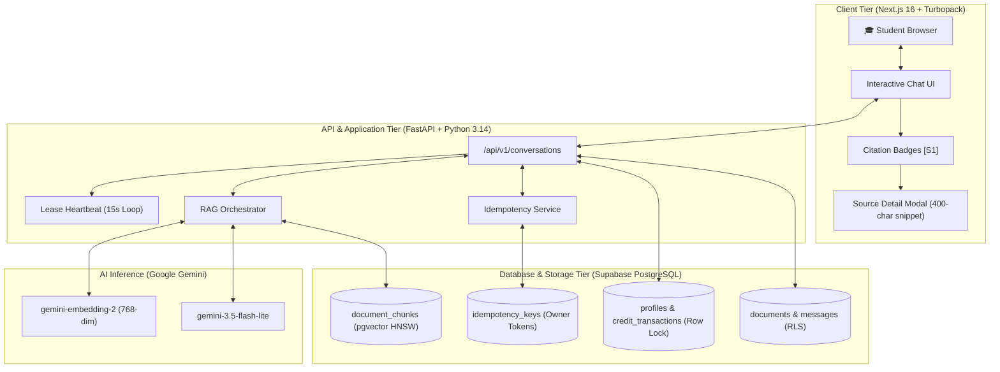

<p align="center">
  
</p>

<h1 align="center">CampusPilot AI 🎓⚡</h1>

<p align="center">
  <strong>Production-Grade AI Academic Copilot & Intelligent Retrieval-Augmented Generation (RAG) Platform for University Engineering Students.</strong>
</p>

<p align="center">
  <a href="https://nextjs.org/"></a>
  <a href="https://fastapi.tiangolo.com/"></a>
  <a href="https://supabase.com/"></a>
  <a href="https://ai.google.dev/"></a>
  <a href="https://www.typescriptlang.org/"></a>
  <a href="https://tailwindcss.com/"></a>
</p>

<p align="center">
  <a href="#-system-architecture">Architecture</a> •
  <a href="#-feature-verification-matrix">Verified Features</a> •
  <a href="#-precision-rag-benchmarks">Benchmarks</a> •
  <a href="#-quickstart--local-development">Quickstart</a> •
  <a href="#-api-reference">API Docs</a> •
  <a href="#-database-migrations">Database</a> •
  <a href="#-author--acknowledgments">Author</a>
</p>

---

## 🌟 Overview

**CampusPilot AI** is an enterprise-ready, full-stack AI learning platform tailored for college and university engineering curricula. It bridges dense academic textbooks, professor lecture slides, and syllabus notes into an interactive, grounded AI study experience.

Unlike generic chatbots that hallucinate or provide detached answers, CampusPilot AI enforces **grounded context retrieval**, **interactive source citations**, **distributed idempotency**, and **strict atomic credit accounting**.

---

## 🏗️ System Architecture



---

## ✅ Feature Verification Matrix

Every feature advertised in CampusPilot AI is backed by operational application code and automated tests:

| Feature Area | Production Capability | Code Implementation | Verification Test Suite | Status |
| :--- | :--- | :--- | :--- | :---: |
| **Grounded Citations** | Clickable `[S1]` badges open a glassmorphic modal with 400-char context snippets, similarity scores, and page numbers. | [`CitationViewer.tsx`](frontend/src/components/CitationViewer.tsx)<br>[`MarkdownRenderer.tsx`](frontend/src/components/MarkdownRenderer.tsx) | `frontend/` (`npm run build` 13/13 routes) | **VERIFIED** |
| **Calibrated RAG** | Cosine similarity cutoff at `0.60` with 100% rejection on unanswerable/out-of-syllabus questions. | [`rag.py`](backend/app/services/rag.py)<br>[`semantic_search.py`](backend/app/services/semantic_search.py) | [`test_e2e_rag_evaluation.py`](backend/tests/test_e2e_rag_evaluation.py) | **VERIFIED** |
| **Distributed Idempotency** | Multi-worker AWS safety with owner-token fencing and periodic 15s lease heartbeat. | [`idempotency.py`](backend/app/services/idempotency.py)<br>[`conversations.py`](backend/app/api/routes/conversations.py) | [`test_live_rag_conversation_suite.py`](backend/tests/test_live_rag_conversation_suite.py) (Scenarios 18–38) | **VERIFIED** |
| **Production Fail-Closed** | Rejects unleased requests and disables SQLite fallback when `APP_ENV=production`. | [`idempotency.py`](backend/app/services/idempotency.py) | [`test_live_rag_conversation_suite.py`](backend/tests/test_live_rag_conversation_suite.py) (Scenario 32) | **VERIFIED** |
| **Atomic Billing** | Single-transaction `SELECT FOR UPDATE` on student balance; zero duplicate charges on retries; rollback on error. | [`conversations.py`](backend/app/api/routes/conversations.py)<br>[`007_idempotency_keys.sql`](backend/migrations/007_idempotency_keys.sql) | [`test_live_rag_conversation_suite.py`](backend/tests/test_live_rag_conversation_suite.py) (Scenarios 1–17) | **VERIFIED** |
| **Multi-Tenant Security** | Student personal documents isolated via RLS; shared curriculum notes available university-wide. | [`002_shared_documents.sql`](backend/migrations/002_shared_documents.sql)<br>[`auth.py`](backend/app/core/auth.py) | [`test_e2e_rag_evaluation.py`](backend/tests/test_e2e_rag_evaluation.py) (Section 4) | **VERIFIED** |
| **Curriculum Hierarchy** | 5 engineering branches, semester modules, subject syllabus nodes, and topic-specific filtering. | [`curriculum.py`](backend/app/core/curriculum.py)<br>[`006_academic_curriculum_structure.sql`](backend/migrations/006_academic_curriculum_structure.sql) | [`test_academic_structure_suite.py`](backend/tests/test_academic_structure_suite.py) | **VERIFIED** |
| **Student Dashboard** | Multi-view layout (Overview, Documents, Learning, Billing, Settings) with focus-trapped modals. | [`src/app/dashboard/`](frontend/src/app/dashboard/) | Next.js App Router (13 static/prerendered routes) | **VERIFIED** |
| **Admin Operations** | Centralized analytics for credit consumption, active subscriptions, waitlist users, and system status. | [`src/app/admin/page.tsx`](frontend/src/app/admin/page.tsx)<br>[`admin.py`](backend/app/api/routes/admin.py) | Unit tests in [`qa_foundation_suite.py`](backend/tests/qa_foundation_suite.py) | **VERIFIED** |

---

## 📊 Precision RAG Benchmarks

Evaluated against a curated multi-subject academic dataset (30 academic chunks across Computer Networks, DBMS, Operating Systems, Computer Organization, and Data Structures; 20 challenging multi-category evaluation queries):

<div align="center">

| Similarity Threshold | Recall@5 | MRR | HitRate@5 | Negative Query Rejection % | Avg Chunks Retrieved |
| :---: | :---: | :---: | :---: | :---: | :---: |
| `0.40` | 0.7647 | 0.7549 | 0.8235 | 0.0% *(High hallucination risk)* | 5.00 |
| `0.50` | 0.7647 | 0.7549 | 0.8235 | 0.0% *(High hallucination risk)* | 5.00 |
| `0.55` | 0.7647 | 0.7157 | 0.8235 | 0.0% | 5.00 |
| **`0.60` (Selected)** | **0.7647** | **0.7010** | **0.8235** | **100.0% (Clean Abstention)** | **4.25** |
| `0.65` | 0.7647 | 0.3971 | 0.8235 | 100.0% | 3.80 |
| `0.70` | 0.7647 | 0.2696 | 0.8235 | 100.0% *(Over-filtering)* | 2.55 |

</div>

### ⏱️ Latency & Cost Profile per Turn
- **Gemini Embedding Latency:** `~609 ms` (`gemini-embedding-2`)
- **pgvector Cosine Search Latency:** `~533 ms`
- **Gemini Generation Latency:** `~850 ms` (`gemini-3.5-flash-lite`)
- **End-to-End Turn Response Time:** `~1.99 s`
- **Total API Cost per Turn:** **`$0.000123 USD`** (over **8,000 student turns per $1.00 USD**)

---

## ⚡ Quickstart & Local Development

### Prerequisites
- **Node.js** `v20.x` or later
- **Python** `3.11` or `3.14`
- **Supabase Project** (or local PostgreSQL with `pgvector` enabled)
- **Google AI Studio Key** (`GEMINI_API_KEY`)

---

### 1. Clone & Configure
```bash
git clone https://github.com/GANDHIKALASI/CampusPilotAI.git
cd CampusPilotAI
```

### 2. Backend Setup
```bash
cd backend

# Create virtual environment
python3 -m venv .venv
source .venv/bin/activate

# Install dependencies
pip install -r requirements.txt

# Configure environment variables
cp .env.example .env
```

Edit `backend/.env`:
```env
APP_ENV=development
DEBUG=True
HOST=0.0.0.0
PORT=8000
GEMINI_API_KEY=your_gemini_api_key_here
GEMINI_MODEL=gemini-3.5-flash-lite
SUPABASE_URL=https://your-project.supabase.co
SUPABASE_PUBLISHABLE_KEY=your_anon_key
SUPABASE_SECRET_KEY=your_service_role_key
```

Run the backend server:
```bash
uvicorn app.main:app --reload --port 8000
```
API Documentation will be live at `http://localhost:8000/docs`.

---

### 3. Frontend Setup
```bash
cd ../frontend

# Install dependencies
npm install

# Configure environment variables
cp .env.example .env.local
```

Edit `frontend/.env.local`:
```env
NEXT_PUBLIC_SUPABASE_URL=https://your-project.supabase.co
NEXT_PUBLIC_SUPABASE_ANON_KEY=your_anon_key
NEXT_PUBLIC_API_URL=http://localhost:8000
```

Start the Next.js development server:
```bash
npm run dev
```
Open [http://localhost:3000](http://localhost:3000) to start learning.

---

## 🧪 Comprehensive Verification Suites

Run the automated test matrix to verify all 50+ backend capabilities:

```bash
# 1. Full Backend Unit & Integration Tests (50/50 Passing)
PYTHONPATH=backend python -m unittest discover -s backend/tests -p "test_*.py"

# 2. Live Conversation Reliability & Idempotency Suite (38/38 Passing)
PYTHONPATH=backend python -m unittest backend.tests.test_live_rag_conversation_suite

# 3. End-to-End RAG Evaluation Benchmark (Reports JSON metrics)
PYTHONPATH=backend python backend/tests/test_e2e_rag_evaluation.py

# 4. Frontend Production Build Check (TypeScript + Turbopack)
cd frontend && npm run build
```

---

## 📡 Core API Reference

| Method | Endpoint | Description | Headers / Key Body Params |
| :--- | :--- | :--- | :--- |
| `POST` | `/api/v1/conversations/{id}/messages` | Send query, execute RAG turn, deduct credit atomically. | `Idempotency-Key: <UUID>`, `{"content": "..."}` |
| `GET` | `/api/v1/conversations/{id}` | Retrieve full conversation turn history and message items. | `Authorization: Bearer <Token>` |
| `POST` | `/api/v1/documents/upload` | Upload PDF syllabus or book; extract text and generate chunks. | `Multipart/form-data: file, scope` |
| `GET` | `/api/v1/academic/curriculum` | List academic branches, semester modules, and topics. | `Authorization: Bearer <Token>` |
| `GET` | `/api/v1/account/credits` | Get student plan status and remaining free/paid AI credits. | `Authorization: Bearer <Token>` |
| `GET` | `/api/v1/admin/analytics` | Admin metrics: active users, total queries, credit usage. | Admin Role Token Required |

---

## 🗄️ Database Migrations

All schema and stored procedure definitions are located in `backend/migrations/`:

```
backend/migrations/
├── 001_phase3_3_schema.sql                  # Baseline profiles, documents, and messages
├── 002_shared_documents.sql                 # Row-level shared vs student document isolation
├── 003_admin_billing_credits.sql            # Billing tiers ('free', 'monthly', 'yearly') & ledger
├── 004_pgvector_storage.sql                 # Vector extension, document_chunks table
├── 005_match_document_chunks_rpc.sql        # match_document_chunks cosine similarity function
├── 006_academic_curriculum_structure.sql   # Engineering branches, semesters, subject taxonomy
└── 007_idempotency_keys.sql                 # Distributed idempotency, owner tokens & atomic turn commit
```

---

## 🛡️ Security & Zero-Secret Guarantee

- **Zero Secrets in Version Control:** `.env*`, database connection strings, and API keys are strictly excluded via hardened `.gitignore` rules.
- **PostgreSQL Row-Level Security (RLS):** All student conversation records and personal uploads are protected by PostgreSQL RLS policies tied to `auth.uid()`.
- **Search Path Hardening:** All PostgreSQL RPC routines explicitly enforce `SET search_path = public, pg_temp;` and `SECURITY DEFINER` to eliminate schema hijacking risks.

---

## 👤 Author & Acknowledgments

Created with passion by **[GANDHIKALASI](https://github.com/GANDHIKALASI)**.  

If you find this project helpful or inspiring, please give it a ⭐️ on [GitHub](https://github.com/GANDHIKALASI/CampusPilotAI)!
