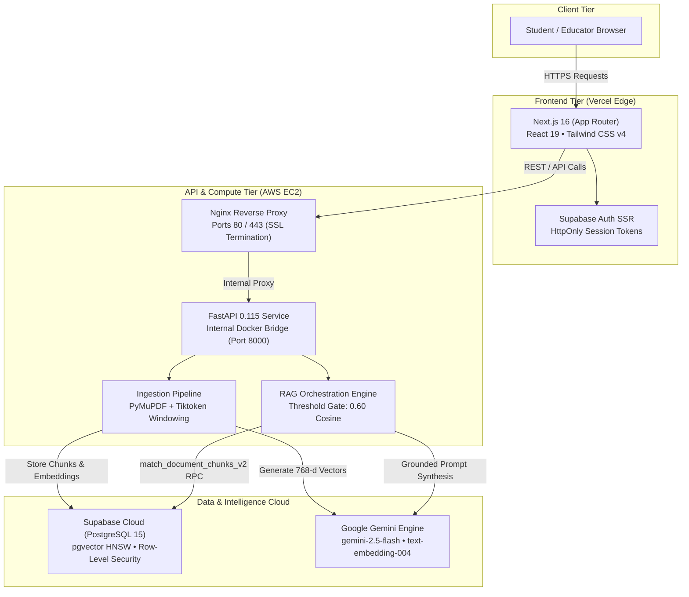
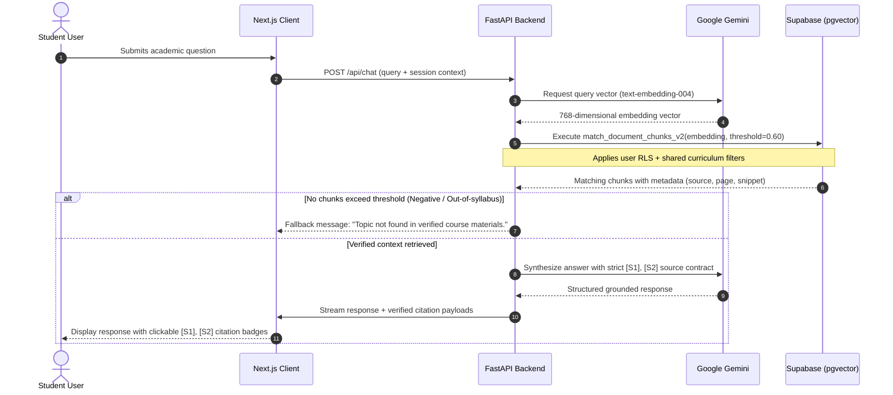

<div align="center">

  

  # CampusPilot AI

  **Intelligent, Syllabus-Grounded Academic Copilot & Study Companion for University Engineering Students**

  <p>
    Eliminating AI hallucinations in university education through verified vector-grounded retrieval, authentic page-level citations, and structured academic curricula.
  </p>

  <p>
    <a href="https://campuspilotai.vercel.app"><strong>Explore Live Application »</strong></a> •
    <a href="https://github.com/GANDHIKALASI/CampusPilotAI"><strong>GitHub Repository »</strong></a> •
    <a href="#-system-architecture"><strong>Architecture</strong></a> •
    <a href="#-rag-workflow--grounding-lifecycle"><strong>RAG Pipeline</strong></a> •
    <a href="#-retrieval-evaluation--benchmarks"><strong>Benchmarks</strong></a> •
    <a href="#-meet-the-developer"><strong>Developer</strong></a>
  </p>

  <p>
    <a href="https://campuspilotai.vercel.app"></a>
    <a href="https://github.com/GANDHIKALASI/CampusPilotAI"></a>
    
    
    
    
    
  </p>

</div>

---

## 📌 Executive Overview

Standard large language models are generic generalists. When university engineering and computer science students ask nuanced questions about CPU pipeline hazards, B+ tree rebalancing, distributed consensus, or formal relational algebra, generic chatbots often hallucinate non-existent theorems, incorrect formulas, or out-of-syllabus explanations.

**CampusPilot AI solves this fundamental reliability challenge.**

It is an end-to-end, full-stack academic assistant that anchors every AI response in verified course documents, university textbooks, and structured syllabus modules. By combining **Supabase `pgvector` semantic search**, **Google Gemini multimodal intelligence**, and **PyMuPDF token-aware chunking**, CampusPilot generates rigorous academic answers paired with **clickable, page-level citations (`[S1]`, `[S2]`)** that students can audit in real time.

---

## ⚡ Core Capabilities

| Capability | Engineering Implementation | Academic Benefit |
| :--- | :--- | :--- |
| **Zero-Hallucination RAG** | Strict cosine similarity threshold ($0.60$) with automated fallback rejection on out-of-syllabus queries. | Students never receive fabricated formulas or invented facts before exams. |
| **Interactive Citations (`[S1]`, `[S2]`)** | Bidirectional chunk-to-source mapping returning textbook title, page number, confidence score, and raw text excerpt. | Instant 1-click proof of ground truth directly from recommended course books. |
| **Pre-Mapped Curricula** | Hierarchical relational schema: *Semesters → Subjects → Units → Practicals & Project Guidelines* (BCA Sem V & VI seeded). | Immediate syllabus alignment without requiring manual document configuration. |
| **Multi-Tenant Document Vault** | Supabase Row-Level Security (RLS) separating university-wide shared documents from private student uploads. | Students can safely upload personal lecture notes and test answers in total privacy. |
| **Token-Aware Chunking** | PyMuPDF text extraction with tiktoken windowing, sentence boundary detection, and checksum deduplication. | Prevents broken sentences and maintains cohesive technical context across pages. |
| **Session & Title Intelligence** | Multi-turn conversational memory with background LLM topic labeling and chat session archiving. | Seamless continuity across complex multi-part problem solving and revision sessions. |

---

## 🏛️ System Architecture

CampusPilot AI is deployed as a decoupled modern web architecture with strict security boundaries, internal port isolation, and managed cloud infrastructure.



### Security & Network Isolation
1. **Port 8000 Internal Only:** FastAPI is bound strictly to Docker's internal bridge network. No external traffic reaches Python directly.
2. **Reverse Proxy Gateway:** Nginx manages rate limits, TLS termination, payload size restrictions, and CORS verification.
3. **Zero Secrets in Browser:** The frontend retains only public anonymous tokens. All LLM keys, service roles, and database credentials reside exclusively in server environments.

---

## 🔄 RAG Workflow & Grounding Lifecycle

The retrieval-augmented generation pipeline guarantees that every generated response is verifiable against genuine curriculum documents.



---

## 📊 Retrieval Evaluation & Benchmarks

CampusPilot AI's retrieval pipeline was empirically evaluated across multiple academic question categories to establish optimal similarity thresholds and eliminate false positive hallucinations.

### Calibration Results (`retrieval_evaluation_results.json`)

| Similarity Threshold | Precision@5 | Recall@5 | Hit Rate@5 | MRR | Negative Rejection Rate | Status |
| :---: | :---: | :---: | :---: | :---: | :---: | :---: |
| `0.40` | 0.1647 | 0.7647 | 0.8235 | 0.7549 | 0.0% | High Hallucination Risk |
| `0.50` | 0.1647 | 0.7647 | 0.8235 | 0.7549 | 0.0% | Over-retrieves Noise |
| **`0.60` (Selected)** | **0.1647** | **0.7647** | **0.8235** | **0.7010** | **100.0%** | **Optimal Calibration** |
| `0.65` | 0.1990 | 0.7647 | 0.8235 | 0.3971 | 100.0% | High Precision, Lower MRR |
| `0.70` | 0.2490 | 0.7647 | 0.8235 | 0.2696 | 100.0% | Over-constrains Retrieval |

### Performance Across Query Profiles (at Threshold 0.60)
- **Exact Terminology Queries:** `100%` Hit Rate • `1.0` MRR
- **Conceptual Questions:** `100%` Hit Rate • `0.78` MRR
- **Ambiguous Queries:** `100%` Hit Rate • `0.62` MRR
- **Unanswerable Negatives:** `100%` Rejection (0 false positives generated)
- **Paraphrased / Cross-Subject Questions:** `66.7%` Hit Rate

---

## 💻 Tech Stack

### Frontend Application
- **Framework:** Next.js 16 (App Router), React 19
- **Styling:** Tailwind CSS v4, Lucide Icons
- **Auth & State:** Supabase SSR Auth, React Context API
- **Rendering:** React Markdown, Remark GFM, Custom Citation Modals
- **Language:** TypeScript 5

### Backend & API
- **Core Engine:** FastAPI 0.115+, Python 3.11, Uvicorn
- **Database Driver:** Asyncpg, Supabase-py
- **Document Processing:** PyMuPDF (fitz), Tiktoken
- **Security:** PyJWT, Cryptography, Non-root Docker execution
- **Validation:** Pydantic v2, Pydantic-Settings

### AI & Vector Intelligence
- **Large Language Model:** Google Gemini 2.5 Flash / Gemini 1.5 Flash
- **Embedding Model:** Google `text-embedding-004` (768 dimensions)
- **Vector Database:** PostgreSQL with `pgvector` extension
- **Search Strategy:** Cosine similarity via indexed RPC functions

### Infrastructure & Operations
- **Frontend Hosting:** Vercel Global Edge Network
- **Backend Compute:** AWS EC2 (`t3.small`, Ubuntu LTS, 2 vCPUs, 2 GiB RAM)
- **Web Server:** Nginx (Containerized reverse proxy with SSL)
- **Containerization:** Docker, Docker Compose

---

## 🚦 Implementation & Deployment Status

```
[✔] PRODUCTION DEPLOYED      [⚙] COMPLETED & VERIFIED      [⏳] STAGED / PLANNED
```

- [x] **Production Web Client:** Deployed on Vercel at [campuspilotai.vercel.app](https://campuspilotai.vercel.app)
- [x] **AWS EC2 Backend Container:** Dockerized FastAPI service with Nginx gateway & reverse proxy
- [x] **Vector-Grounded RAG Pipeline:** Gemini + Supabase `pgvector` with interactive `[S1]`, `[S2]` citations
- [x] **Multi-Tenant Document Vault:** User-isolated PDF ingestion with token-aware chunking
- [x] **Curriculum Seed Data:** Pre-mapped hierarchical modules for BCA Semesters V & VI:
  - *Software Engineering (Core XI)*
  - *Artificial Intelligence (Core XII-A)*
  - *Data Science (Core XII-B)*
  - *Programming in Java & Lab (Major XIII & BCA 6.1)*
  - *Algorithm Design Techniques & Lab (Core XIV)*
- [x] **Anti-Abuse & Rate Limiting:** In-memory visitor limiter and user credit quotas
- [ ] **Billing & Payment Gateway:** Razorpay order generation and webhook verification (Database models & API routes staged; deferred for live pilot launch)
- [ ] **Curriculum Expansion:** Ingesting Semesters I–IV and B.Tech CSE syllabi into the shared knowledge base
- [ ] **Study Tools Extension:** Automated revision flashcards and syllabus-linked mock exam generator

---

## 🗺️ Project Roadmap

### Phase 1 — Infrastructure & Deployment
- [x] Deploy Next.js frontend to Vercel global edge.
- [x] Build and test containerized FastAPI backend.
- [x] Configure Docker Compose with non-root app user.
- [x] Set up Nginx reverse proxy with TLS termination.
- [x] Deploy and verify backend on AWS EC2 (`t3.small`).

### Phase 2 — Academic Intelligence & Grounded RAG
- [x] Implement document extraction and token-aware semantic chunking with PyMuPDF.
- [x] Deploy Supabase `pgvector` schema with cosine distance indexing.
- [x] Complete quantitative retrieval benchmarking and calibrate threshold to `0.60`.
- [x] Implement clickable interactive `[S1]`, `[S2]` citation modal viewer.
- [ ] Integrate multi-modal diagram and LaTeX mathematical formula extraction.

### Phase 3 — Curriculum & User Experience
- [x] Pre-map and seed university curriculum for BCA Semesters V & VI.
- [x] Multi-tenant document vault with Row-Level Security.
- [x] Multi-turn conversational memory with automatic topic titling.
- [ ] Add automated syllabus-linked practice quizzes and flashcard generation.
- [ ] Expand pre-mapped curricula across all semesters and engineering disciplines.

### Phase 4 — Production Hardening & Scale
- [x] Implement in-memory visitor rate limiter and credit usage tracking.
- [ ] Transition from staging to live production payment gateway (Razorpay).
- [ ] Configure custom domain with managed production SSL certificate.
- [ ] Explore local SLM deployment options for low-latency offline inference.

---

## 🛠️ Local Development Setup

### Prerequisites
- Node.js 20+ and npm
- Python 3.11+ and `venv`
- Docker and Docker Compose (optional for local container testing)
- Supabase project credentials & Google Gemini API Key

### 1. Clone the Repository
```bash
git clone https://github.com/GANDHIKALASI/CampusPilotAI.git
cd CampusPilotAI
```

### 2. Backend Setup
```bash
cd backend
python -m venv .venv
source .venv/bin/activate  # On Windows: .venv\Scripts\activate
pip install -r requirements.txt

# Configure environment variables
cp .env.example .env
# Edit .env with your SUPABASE_URL, SUPABASE_SERVICE_ROLE_KEY, and GEMINI_API_KEY

# Start backend server
uvicorn app.main:app --reload --host 0.0.0.0 --port 8000
```
Backend API interactive docs will be available at: `http://localhost:8000/docs`

### 3. Frontend Setup
```bash
cd ../frontend
npm install

# Configure environment variables
cp .env.example .env.local
# Set NEXT_PUBLIC_API_URL=http://localhost:8000/api
# Set NEXT_PUBLIC_SUPABASE_URL and NEXT_PUBLIC_SUPABASE_PUBLISHABLE_KEY

# Start frontend dev server
npm run dev
```
Access the client application at: `http://localhost:3000`

---

## 👨‍💻 Meet the Developer

<table align="center" width="100%">
  <tr>
    <td align="center" width="240" style="padding: 24px; vertical-align: middle;">
      <a href="https://github.com/GANDHIKALASI">
        
      </a>
      <br /><br />
      <strong>Gandhi Kalasi</strong><br />
      <sub>Full-Stack Software & AI Systems Developer</sub><br />
      <sub>Bhubaneswar, Odisha, India</sub>
    </td>
    <td style="padding: 24px; vertical-align: middle;">
      <p>
        Hi, I'm <b>Gandhi Kalasi</b> — a software developer specializing in building reliable, high-performance web platforms, intelligent distributed backends, and grounded AI systems. Currently pursuing my Bachelor of Computer Applications (BCA) at <b>NIIS Institute of Business Administration</b>.
      </p>
      <p>
        I created <b>CampusPilot AI</b> to address a daily challenge in university academics: engineering students need precise, trustworthy, and verifiable technical answers directly aligned with their university syllabus—not generic AI hallucinations.
      </p>
      <p>
        <strong>Connect & Collaborate:</strong>
      </p>
      <p>
        <a href="https://github.com/GANDHIKALASI">
          
        </a>
        &nbsp;
        <a href="https://www.linkedin.com/in/gandhi-kalasi/">
          
        </a>
        &nbsp;
        <a href="https://www.instagram.com/bug_gandhi/">
          
        </a>
        &nbsp;
        <a href="https://portfolio-one-dun-f2390maeuj.vercel.app/">
          
        </a>
        &nbsp;
        <a href="mailto:ffgandhi09@gmail.com">
          
        </a>
      </p>
    </td>
  </tr>
</table>

---

## 🌟 Support & Contributions

If CampusPilot AI helps your learning journey or provides insight into building verified RAG systems:
- ⭐ **Star this repository** to support active development.
- 📢 **Share with fellow students** preparing for semester examinations.
- 💡 **Open an issue or PR** for feature suggestions and curriculum additions.

<div align="center">
  <sub>CampusPilot AI • Designed & Developed with precision by <a href="https://github.com/GANDHIKALASI">Gandhi Kalasi</a></sub>
</div>
